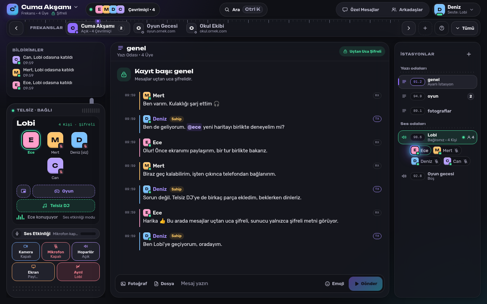
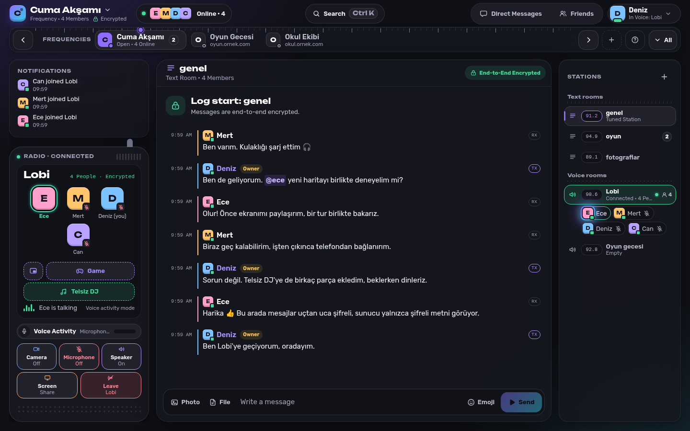
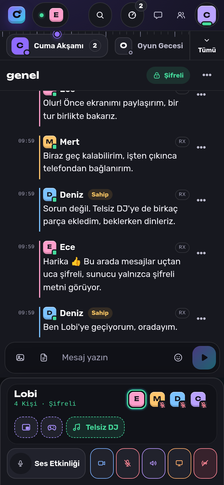
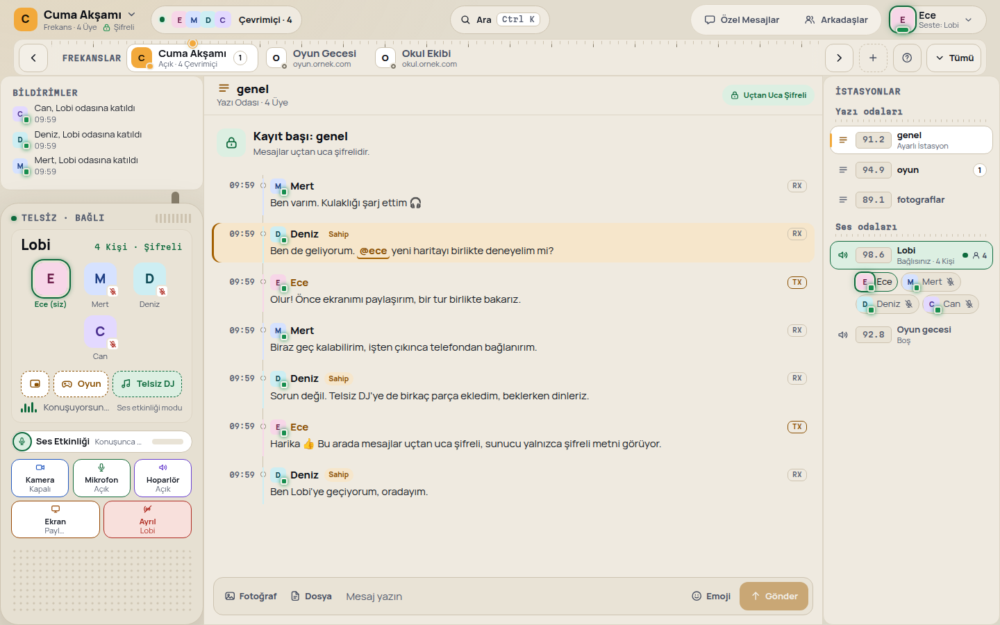
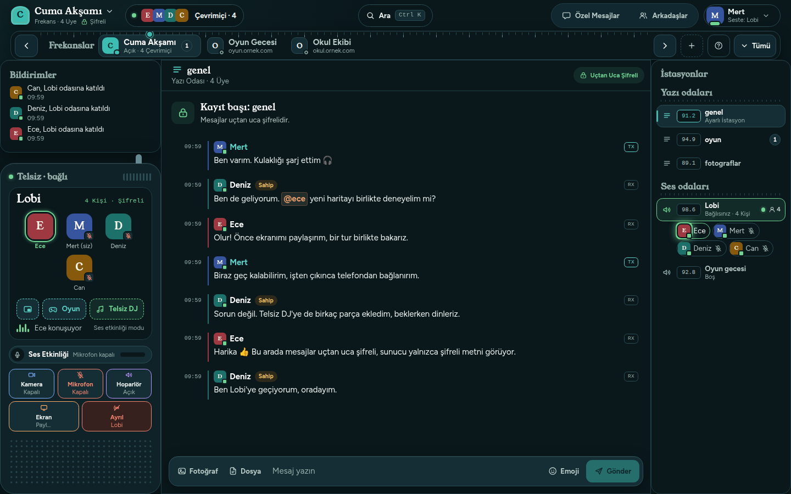
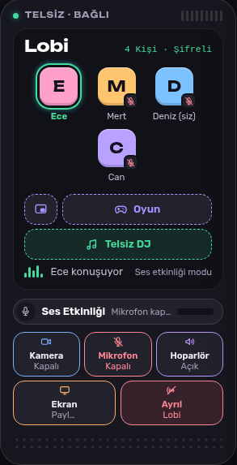
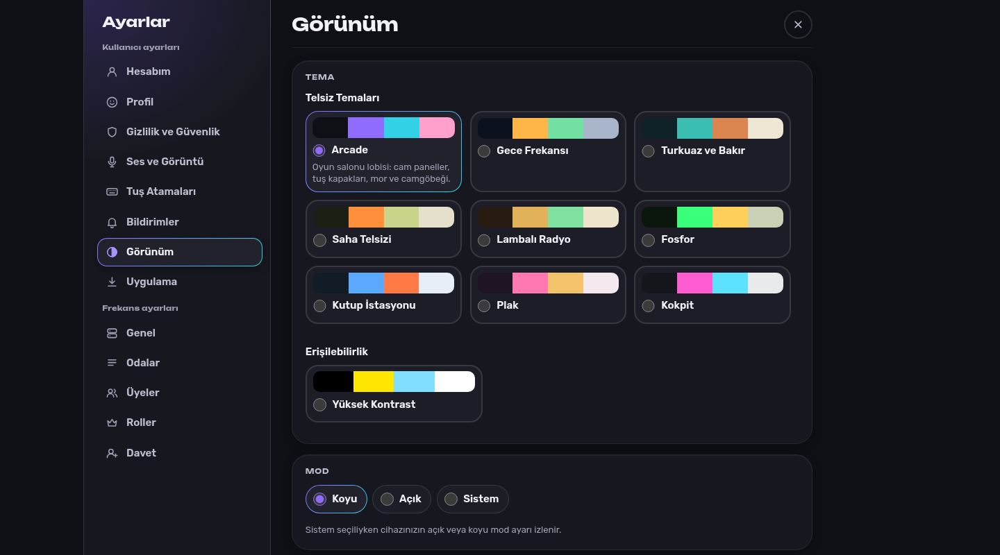

# Telsiz

[Türkçe](README.md) | [English](README.en.md)

Telsiz is an open source (MIT), self-hosted, end-to-end encrypted app for text and voice communication. The server runs on the computer of one person in the group, on a home server or on a rented server, and everyone connects with a browser. The same interface opens on Windows PCs, Macs, Linux, Android and iOS phones, tablets and game console browsers. Anyone can install Telsiz as an app or use the desktop app built for Windows and Linux.

Every Telsiz server is a **frequency**: a community with its own name, rooms, members and encryption key. One person can join several frequencies, and the joined frequencies are lined up on the frequency band at the top of the screen.

Messages, files, profiles and the setup messages of voice connections are encrypted on the device. The server stores and relays this content only in encrypted form. The server has no runtime dependencies. It runs on Node.js 20 or newer, or as a single file build that does not need Node.js.



## Features

**The frequency band and rooms.** Telsiz is laid out like a radio dial. The frequencies you have joined sit as stations on a horizontal frequency band at the top of the screen. A needle above the band shows the open frequency, and pressing another station or dragging and dropping the needle with a mouse or a finger switches to that frequency. Each station shows the status of the frequency (open, online, offline, sign-in needed) and its unread and mention counts. The text and voice rooms of the open frequency are in the Stations list in the right column: unread and mention badges, the number of people in a voice room and, under the room, the people in it (avatar, name, mute and camera icons, a ring around the person speaking), a speaking indicator and the Telsiz DJ note, and an Add room button for people with the manage rooms permission. While Telsiz DJ is playing, the list stays at the top of the right column and the DJ card sits below it. On narrow screens and phones the list opens from the Stations button in the top bar. On wide screens the radio card sits at the bottom of the left column with the Notifications list above it, and the wide conversation column sits in the middle. The Notifications list shows screen shares that start in your voice room with a Watch button, and people joining and leaving voice rooms and tracks added to Telsiz DJ in your voice room in short lines. The top bar has the frequency name on the left with the Online button right next to it, Search in the very middle, and the Direct messages and Friends buttons and the avatar menu on the right. Your profile, status and settings are in the avatar menu. The ? button at the end of the band opens the guide to changing frequencies.

**Several frequencies.** The + button of the band adds a new frequency address (`https://`, or `http://localhost` for a server on this computer), and the All button lists the frequencies with their status and counts in a sheet, where they can be removed from the list. The frequency name on the left of the top bar shows the details of the open frequency and shortcuts to its settings. In the desktop app each frequency keeps its own sign-in, switching happens in the same window, and the app stays connected in the background to the 8 most recently used frequencies to show their unread counts and mentions. In the browser each frequency is a separate site: the list is kept in that browser, switching takes the tab to the other address, and the list travels to the other frequency in the `#` part of the address (only addresses and names, never keys). Frequencies added to the list this way are announced with their addresses and do not change the order of an existing list, and a new frequency that carries the name of another frequency in the list shows its address instead of that name. In the browser the status, notifications and unread counts of frequencies that are not open are not shown. Switching ends the voice connection (you are asked first while in a voice room), and the list is not synced between devices.

**End-to-end encrypted messaging.** Messages, photos and files in text rooms are encrypted with the group key, and direct messages with the personal keys of the two people. Photos other than GIFs are re-encoded on the device before they are sent, which removes metadata including the location. A message can carry up to 10 files, and a file can be up to 25 MB by default. Messages can be edited and deleted, and there is an emoji picker, @ mentions and a typing indicator. In direct messages the other person's key can be verified with a safety number.

**Friends and direct messages.** Users can send each other friend requests by username, accept them and block people. Messages from a blocked person in text rooms are collapsed and their voice is muted on your side.

**Reports.** Someone else's message can be reported to the frequency owner and admins with Report Message in the message toolbar or the Message actions menu, and a person with Report User on their profile card. You choose a reason (Spam, Harassment, Illegal content or Other) and can write an optional note. The text of a message in a text room is attached to the report automatically, while the text of a direct message is attached only if you tick the box. The note and the message text are encrypted with the group key, the server only sees who reported whom, which message and for what reason. Telsiz does not show the report to the reported person. The owner and admins see reports in Settings > Members > Reports, jump to a message in a text room with Go To Message and close a report with Mark Resolved. New reports appear on their own while the list is open. A person can send at most 10 reports per hour, and the server keeps at most 500 reports.

**Status and automatic idle.** The Online, Idle, Do Not Disturb or Invisible status and an encrypted custom status text are chosen from the avatar menu. Do not disturb mutes notifications and message sounds, and an invisible person appears offline to others. Automatic idle is on by default: if the mouse, keyboard, touch or a gamepad is not used on a device for 10 minutes, that device counts as idle. Once all of a person's open devices and tabs are idle, others see the person as Idle, the person's own status reads "Idle (automatic)", and the first input brings them back to Online. A device in a voice room never counts as idle on that frequency. The desktop app also counts use of other apps on the computer, but being in a voice room on one frequency does not affect the background windows of the other frequencies. Automatic idle only affects the Online status, never touches a status you chose yourself and is not written to disk. It can be turned off for this device in Settings > Privacy, where the time can be set to 5, 10, 15, 30 or 60 minutes. The server and members can see when a person went inactive. In the browser the timers of a background tab can be slowed down, so the decision may be up to about a minute late.

**Voice chat.** Audio flows directly between people over WebRTC and does not pass through the server. You choose between voice activity detection (with an automatic or manual threshold) and push to talk. The choice can also be made from a small menu that opens when you right click the microphone button (Shift+F10 on the keyboard). A keyboard key, a mouse side button or a gamepad button can be assigned to push to talk, mute and deafen. When you join a voice room, a radio card that looks like a handheld radio opens: the people in the room, a halo around the speaker, a large Push to talk button, and buttons in two rows, each in its own color (Camera, Microphone and Deafen on top, Screen and Leave below, on phones only icons in a single row). The volume of each person can be set between 0% and 200%, and anything above 100% boosts that person's voice on the device. Because the boosted voice plays from the browser's audio context, Chromium's echo cancellation may not take it into account, so echo may reach the other side when you use speakers. Headphones avoid this. A distinct 2 second notification sound plays when someone joins or leaves the voice room, when someone starts a screen share, when a direct message or a friend request arrives and when you drop out of the voice room. The sounds are not played from files, they are synthesized on the device. Their volume is set with the slider in Settings > Notifications (40% by default), where each sound can also be played. Advanced noise suppression (RNNoise) suppresses non-speech sounds such as keyboard clicks on the device before they reach others, and it is on by default. By default up to 8 people can join a voice room, and the owner of the frequency can change this limit between 2 and 12 people in Settings > General.

**Screen sharing.** Anyone in a voice room can share their screen, a window or a tab. When a share starts, it appears with a Watch button in the Notifications list of the people in the same voice room, and hovering over the person sharing in the crew of the radio card also shows a Watch stream button (always visible on touch screens). Video is sent only to people who start watching. The person sharing chooses between smooth motion and sharp text, a resolution of 720p or 1080p, and a frame rate of 15 or 30. Whether audio is shared is chosen only in the window where the source is picked (the browser's picker, or the app's own picker in the desktop app). The audio is requested with the `restrictOwnAudio` constraint, which leaves out Telsiz's own sounds: the desktop app and browsers that support it remove the conversation, notification sounds and Telsiz DJ playing in Telsiz from the shared audio. On older Windows versions that do not support this separation, all system audio is shared. The person sharing can close the preview with Minimize in the stage header: sharing continues, and Show Preview appears in the chip in the top bar. This choice is remembered on the device, and on a phone the preview is always visible. The Floating Window button in the header opens the room and a Stop button for the person sharing, and the watched stream for the viewer, in a floating window.

**Camera.** Anyone in a voice room can turn on their own camera with the Camera button on the radio card. The camera is off by default and is never requested before the button is pressed. Video is sent at 640x360 and 15 fps, like audio directly between people and encrypted with WebRTC's DTLS-SRTP, and the Telsiz server does not see it. The crew avatar of someone with their camera on turns into a live video tile with the same soft-square shape, your own video is mirrored (except the rear camera), and while your camera is on an always-visible indicator stays on the radio card. On a phone the camera opens with the front camera, and on a device with more than one camera the Flip Camera button next to the indicator switches between the front and rear camera (the next camera on a computer). The same button is also available in a direct message call. On a tablet with front and rear cameras, a plugged in camera also joins the cycle. If a camera plugged into a computer is selected, that camera is requested even after the page is reloaded. The Enlarge button under the crew shows the number of cameras that are on and opens the cameras in a large grid. In the grid you choose between Fit and Fill (Fill by default, and the choice is kept separately from screen sharing). While the grid is open, the Stations list in the right column stays in place and the latest messages stay open below the grid. The owner can turn cameras off and set how many cameras can be on at the same time in a voice room (default 4). Someone with the voice room moderation permission can turn off the camera of a person ranked lower from that person's volume card or profile card. This happens once, and the person can turn their camera on again. In a full mesh everyone with their camera on sends their video separately to every other person in the room, so as people and cameras increase, members' upload speed may not be enough.

**Floating window.** While you're in a voice room or a direct message call, the cameras in the room, or profile photos when there are no cameras, appear in a small always-on-top window. People with their camera on are shown in large tiles (at most 4), people with their camera off in a small strip below (at most 8), a green ring lights up around the person speaking, and those who don't fit are shown as "+N people". If you're watching a screen share, the window shows that stream. The window has Microphone, Back to App and Close buttons. A Leave button is deliberately left out so it can't be pressed by accident. In the desktop app the floating window opens by itself when the window is minimized or hidden to the tray, and closes when the window comes back. On Windows and macOS this window is excluded from screen sharing, on Linux it is not, and in a Wayland session it can't stay on top. In the browser the Floating Window button on the radio card opens it: a document picture-in-picture window in Chrome, Edge and desktop Firefox 151 and later, and in browsers without it (e.g. Safari, Android Chrome) a video window without buttons is tried. The video window has only been tested in Chromium. Chrome and Edge also open the window by themselves when you switch away from the tab with the voice room, but not when the browser is minimized. Opening by itself can be turned off for this device under Settings > Voice and Video > Floating Window. The floating window in the browser may appear in full-screen shares. The floating window sends nothing to the server.

**Calls in direct messages.** Two friends can call each other with the Voice Call or Video Call button in the header of a direct message conversation. The phone rings on all of the callee's open devices and an incoming call card opens with Accept and Decline buttons (in Do not disturb the ring is silent and the card still shows). The camera only turns on by the person's own choice: for a video call Accept joins with the camera and Accept Without Camera joins with audio only. During the call the top of the conversation shows both people's cameras, or their profile photos when the camera is off, and the conversation continues below. Audio and video flow directly between the two people, encrypted with DTLS-SRTP. The call setup messages are encrypted with the two people's personal keys, so other members of the frequency and the server cannot open them, and the rest of the frequency does not see who is calling whom. Calls are only possible between friends and while the other person's key is verified, and blocking or removing a friend ends a running call.

**Server information and capacity recommendation.** The owner and admins see the server's processor, load average, memory, the disk of the data folder, usage figures and the TURN status in Settings > General. From the members' typical upload speed, a recommendation for the voice room capacity and camera limit is calculated and clearly labelled as an estimate, along with hints from the server information. The Apply recommendation button fills the values into the form.

**Telsiz DJ.** Voice rooms have a built-in music bot. Typing `/play` and a YouTube link in the message box, or pressing "Play in DJ" on an audio file in a message, adds the track to the queue. If the owner has turned on search by song name, a song name can also follow `/play` (for example `/play lobby song`): the server searches YouTube for it and adds the first playable result with its name. If search is off or fails, a clear error message and a Search on YouTube link on the DJ card appear. The link opens YouTube's results page in a new tab, and the link of the track found there is added with `/play`. The addition is announced in the text room with the track's name and shows up in the Notifications list of the other people in the voice room. The name of a YouTube track is awaited for up to 8 seconds, and if it arrives later the announcement goes out without it and is edited once the name arrives. Everyone hears the track at the same time on their own device: a new track, a track change and resuming are anchored 3 seconds ahead for YouTube tracks and 1.5 seconds ahead for audio files, so everyone loads and starts from the same point. YouTube tracks load in the official YouTube embedded player, and only after the person gives consent on that device. While a YouTube track is playing in the room, a person who has not given consent yet sees a notice with a Load the YouTube Player button on the radio card. Shared audio files play without consent. When the DJ card is not visible, the player sits in a corner of the screen as a small player: it can be dragged by its bar and dropped in one of the four corners, the Move button goes through the corners in turn, and the chosen corner is stored on the device. In a bottom corner the player moves above the message box and the radio card as long as there is room, the default corner does not cover the card's buttons, and the player sits in a bottom corner while Settings is open. Minimize leaves only the bar, and the Floating Player switch keeps the player in the corner even while the card is visible. Audio file tracks keep playing while minimized and while the tab is in the background. A YouTube track only plays while its player is visible: when it is minimized, or when the desktop app's window is minimized or hidden in the tray, it pauses on that device only and resumes in sync with the room when it is shown again. Telsiz DJ gives the name of the playing track to your system's media controls and lock screen (Media Session), which can be turned off in the Media controls section of Settings > Privacy. Play and Pause there only affect that device. The bar of the player in the corner shows a pause on that device, and its Resume on This Device button resumes without affecting the room. The owner of the frequency can turn off Telsiz DJ or only the YouTube source.

**Search by song name (a warning for owners).** This search is off by default, and the owner turns it on in Settings > General > Music bot through a confirmation dialog. The search does not use the official YouTube API: the server itself calls the search endpoint that YouTube's web page uses. YouTube's Terms of Service prohibit automated access, so turning on the search goes against the Terms of Service, and the server owner takes on the risk. YouTube may block the server's address or change its response format, in which case the search turns off for one hour after repeated failures and a warning is written to the server log. Adding by link always works. Unlike the DJ state, the search text is not encrypted: it goes to the server and, from the server's IP address, to YouTube. The client's address does not go to YouTube, and the text is not logged. This feature has never been tried against the real YouTube in the development environment, and the first live test has to be done on the server ([docs/DEPLOYMENT.md](docs/DEPLOYMENT.md#youtube-search-by-song-name)).

**Search on the device.** Message search runs entirely on the device. The server never sees the search text or the message content.

**Frequency introduction.** Someone who is not signed in first sees an introduction page when they open the frequency address: the frequency name, the public introduction text the owner writes in Settings > General, a short description of Telsiz, a link to download the desktop app and a step by step guide to setting up a frequency. People who arrive through an invite link go straight to the sign-up form.

**Frequency photo.** Every frequency can have its own photo. The owner picks an image in Settings > General, and it is cropped to a square from its center and scaled down to 256x256. The photo replaces the first letter on the frequency button in the top bar, in the frequency band, on the Frequencies sheet, on the sign-in screen and on the introduction page. In the desktop app the band also shows the photos of other frequencies. Like the frequency name, the frequency photo is public and not encrypted.

**Appearance.** There are three themes: Arcade, Night Frequency (Gece Frekansı) and Turquoise and Copper (Turkuaz ve Bakır). Each has a dark and a light mode, and the mode can follow the system setting. Avatars are soft squares in every theme. There are options for font size (Normal, 15 pixels, by default), a compact message view and reduced motion. The font size can also be set by hand between 12 and 28 pixels with the Custom size slider in Settings > Appearance. The interface is in Turkish and English.

**On every device.** The interface works with a mouse, keyboard, touch screen and gamepad. At TV width (1800 pixels and up) text and the focus ring grow, and when a gamepad is detected a controller hint bar appears at the bottom. Telsiz can be installed as an app (PWA) on phones, tablets and computers.

**Installation options.** An npm package (`npx telsiz`), a single file server for Windows and Linux that does not need Node.js, a Docker image on the GitHub Container Registry, a desktop app for Windows and Linux, and start scripts in the repository.

## Screenshots

| | |
| --- | --- |
|  |  |
| English interface | Phone view |
|  |  |
| Night Frequency, light mode | Turquoise and Copper, dark mode |
|  |  |
| Radio card in a voice room | Full screen settings |

## Quick start

Whichever path you choose, the server prints a one time setup code to the console on first start. You then open the server address in a browser and create the owner account with that code (see [First run and invites](#first-run-and-invites)). The server listens on port 3000 by default, and on the computer that runs it the address is `http://localhost:3000`. The detailed installation guide is in [docs/DEPLOYMENT.md](docs/DEPLOYMENT.md).

### With npm

Node.js 20 or newer is required.

```sh
npx telsiz
```

For a permanent installation, run `npm install -g telsiz` and then the `telsiz` command. Data is written to the `veri` folder inside the folder where the command runs, so always run the command in the same folder or set a fixed folder with the `VERI_KLASORU` (`DATA_DIR`) setting.

### Single file for Windows

1. Download `telsiz-<version>-server-windows-x64.exe` from the [Releases](https://github.com/Yerlifan/telsiz/releases) page.
2. Put the file in an empty folder of its own.
3. Double click the file. If Windows SmartScreen shows a warning, choose "More info" and then "Run anyway".

Data is written to the `veri` folder next to the file. Settings are read from a `telsiz.env` file that you place next to it. Keep the window open while the server runs.

### Single file for Linux

Separate files are published for x64 and arm64 (for example Raspberry Pi).

```sh
chmod +x telsiz-<version>-server-linux-x64
./telsiz-<version>-server-linux-x64
```

### From the repository

Node.js 20 or newer is required.

```sh
git clone https://github.com/Yerlifan/telsiz.git
cd telsiz
./baslat.sh
```

On Windows, download the repository and double click `baslat.bat`. On macOS use `baslat.sh`.

### With Docker

```sh
docker run -d --name telsiz -p 127.0.0.1:3000:3000 -e GUVENILIR_VEKIL=172.17.0.1 -v telsiz-veri:/data ghcr.io/yerlifan/telsiz:latest
docker logs telsiz
```

The second command shows the setup code. The `GUVENILIR_VEKIL` setting is the Docker gateway address that a reverse proxy or tunnel on the host connects from. Without it every client is counted as the same address and the rate limits apply to everyone together, see [docs/DEPLOYMENT.md](docs/DEPLOYMENT.md) for details. The [deploy/docker-compose.yml](deploy/docker-compose.yml) file in the repository starts Telsiz, optionally together with Caddy for automatic HTTPS.

### Desktop app

The Releases page has an installer (`Telsiz-Kurulum-<version>.exe`) and a portable build (`Telsiz-<version>-tasinabilir.exe`) for Windows, and an AppImage and a .deb package for Linux. The desktop app is a client, not a server. The interface ships inside the app and is never downloaded from the server. The installer and the AppImage download a new version in the background and install it when you choose Restart and update, the portable build and the .deb only announce a new version. The check connects to GitHub and can be turned off in Settings > App. Details are in [desktop/README.en.md](desktop/README.en.md).

## First run and invites

1. Start the server and note the setup code shown inside a frame in the console.
2. Open the server address in a browser.
3. On the setup screen, enter the setup code, your username and your password. This account becomes the owner of the frequency (this server).
4. Telsiz creates an encryption key for the group and shows the invite screen. Copy the invite link and share it with your friends.

The invite link carries the invite code and the encryption key in the part of the address after the `#` sign. Browsers do not send this part to the server, but anyone who sees the link also learns the key. Share the link only over channels you trust. The key code can also be typed by hand. The invite code can be renewed later in Settings > Invite.

Owners and admins manage rooms in Settings > Rooms and members in Settings > Members. In Settings > Roles the owner can create custom roles such as a moderator and grant the delete messages, ban, voice room moderation, manage rooms and Telsiz DJ permissions one by one. The ban permission also covers kicking a member ranked lower with the Kick button in Settings > Members: the person's account is deleted, their sessions are signed out, their messages stay, and they can come back only by registering again with an invite code. The owner can never be kicked. The voice room moderation permission covers muting someone ranked lower for everyone, turning off their camera and removing them from the voice room. The frequency name and the switches for Telsiz DJ, the YouTube source, DJ restricted mode and YouTube search by song name are in Settings > General and can be changed only by the owner.

## HTTPS and going online

Browsers allow the microphone and screen capture only on secure addresses. Voice chat, screen sharing and installing as an app therefore need an address that starts with `https://`, or the `http://localhost` address on the computer that runs the server. On a home network address such as `http://192.168...` messaging works but voice does not.

There are three ways to reach friends on the internet. The `tunel.bat` (Windows) and `tunel.sh` (Linux and macOS) scripts in the repository open a temporary https address with a Cloudflare quick tunnel, which needs no account. That address changes on every run. For a permanent address you can use your own domain with a reverse proxy such as the examples in [deploy/Caddyfile](deploy/Caddyfile) and [deploy/nginx.conf](deploy/nginx.conf). The Docker Compose example includes Caddy ready to use. Details are in [docs/DEPLOYMENT.md](docs/DEPLOYMENT.md).

## Devices

**Phones, tablets and computers.** When Telsiz is opened at an https address it can be installed as an app. In browsers that support it, an "Install app" button appears in Settings > App. On iPhone and iPad, use "Add to Home Screen" in the Share menu of Safari. An installed app is bound to the address it was installed from.

**Desktop app.** The desktop app for Windows and Linux carries the interface inside itself and verifies the integrity of its files at startup. It remembers several frequencies (address and sign-in), switches between them in the same window and counts the unread messages of frequencies that are not open in the background. It offers global shortcuts for mute, deafen and push to talk that also works while the app is in the background (press to start and stop, or hold to talk with an optional key hook), and an option to minimize to the system tray. While you're in a voice room, minimizing the window or hiding it to the tray shows the cameras or profile photos in the room in an always-on-top floating window.

**TVs and game consoles.** On wide screens the interface opens with large text and large buttons and can be navigated with the arrow keys. The PS5 has no official browser app, and voice chat in console browsers has not been verified. The person at the console can join voice chat with the same account from their phone.

## Security at a glance

The password is never sent to the server. The browser derives an authentication key and a separate wrapping key from the password with scrypt. Group content is encrypted with TweetNaCl-js using XSalsa20-Poly1305, and direct messages with a shared key established over X25519. The server checks authorization on every request, validates input, and applies rate limits and a strict Content Security Policy.

End-to-end encryption does not hide everything. The server sees who is online, if automatic idle is on when someone went inactive, who is in which room and voice room, the timing and size of messages, room names, usernames, the typing status and, for reports, who reported whom and for what reason. If the owner has turned on search by song name, it also sees the song names searched with `/play`. In the web version the app code comes from the server, so an active attacker who takes over the server could serve modified code. The group key has no forward secrecy. In voice and video chat people can see each other's IP address. The project has not had an independent security audit. The full list of limits is in [docs/ARCHITECTURE.md](docs/ARCHITECTURE.md#limits), and the way to report a vulnerability is in [SECURITY.md](SECURITY.md).

## Settings

The server is configured with environment variables. Each setting has a Turkish name and an English alias, and if both are set the Turkish name wins. The single file server also reads the same settings from a `telsiz.env` file next to it (one `NAME=value` per line), and environment variables take precedence over that file.

| Setting | Default | Description |
| --- | --- | --- |
| `PORT` | `3000` | The port to listen on. If you change it, give the tunnel script the same value. |
| `HOST` | `0.0.0.0` | The address to listen on. Use `127.0.0.1` for access from this computer only. |
| `SUNUCU_ADI` (`SERVER_NAME`) | `Telsiz` | The initial name, used only on first setup, at most 40 characters. Later it is changed in Settings > General. |
| `VERI_KLASORU` (`DATA_DIR`) | `veri` in the working folder | The folder where data is written. For the single file server it is the `veri` folder next to the file. |
| `MAKS_YUKLEME_MB` (`MAX_UPLOAD_MB`) | `25` | The largest size of a single file (MB), at most 1024. |
| `YUKLEME_KOTASI_MB` (`UPLOAD_QUOTA_MB`) | `2048` | The total limit for all uploads (MB). |
| `KULLANICI_YUKLEME_KOTASI_MB` (`USER_UPLOAD_QUOTA_MB`) | `512` | The total limit for one user's stored uploads (MB). |
| `MAKS_TOPLAM_MESAJ` (`MAX_TOTAL_MESSAGES`) | `500000` | The total number of messages stored across all conversations. When it is exceeded, the oldest messages of the largest conversations are removed. |
| `STUN_URL` | `stun:stun.l.google.com:19302` | Comma separated STUN addresses. If left empty, no STUN server is used. |
| `TURN_URL` | empty | Comma separated TURN addresses (`turn:` or `turns:`). Some networks need it for voice. |
| `TURN_KULLANICI` (`TURN_USERNAME`) | empty | TURN username. |
| `TURN_SIFRE` (`TURN_PASSWORD`) | empty | TURN password. |
| `GUVENILIR_VEKIL` (`TRUSTED_PROXY`) | `loopback` | Proxy addresses whose `X-Forwarded-For` and `CF-Connecting-IP` headers are trusted: `loopback`, `none`, IP addresses or CIDR blocks, comma separated. |
| `DIL` (`TELSIZ_LANG`) | system language | The language of console messages: `tr` or `en`. |

If the owner forgets the password, the `sifre-sifirla <username>` command (in English `reset-password`) creates a temporary password while the server is stopped, for example `npx telsiz reset-password deniz` or `node server.js reset-password deniz`. This resets the person's security key, so their old direct messages can no longer be read.

## Documentation

| Document | Contents |
| --- | --- |
| [docs/DEPLOYMENT.md](docs/DEPLOYMENT.md) | Self-hosting: npm, single file, Docker, reverse proxy, tunnel, TURN, backups and updates |
| [docs/ARCHITECTURE.md](docs/ARCHITECTURE.md) | Server, client, encryption, voice, screen sharing, Telsiz DJ, desktop app and limits |
| [docs/DESIGN.md](docs/DESIGN.md) | Frequency layout, design tokens, themes and accessibility |
| [desktop/README.en.md](desktop/README.en.md) | Security architecture and development commands of the desktop app |
| [CONTRIBUTING.en.md](CONTRIBUTING.en.md) | Contribution guide and code rules |
| [SECURITY.md](SECURITY.md) | Security policy and vulnerability reporting |
| [CHANGELOG.en.md](CHANGELOG.en.md) | Release notes |

## Contributing and license

Bug reports, test results from real devices, translation fixes and code contributions are welcome. Read [CONTRIBUTING.en.md](CONTRIBUTING.en.md) before you start.

Telsiz is developed by Burak Aslancan Pak and distributed under the [MIT license](LICENSE). TweetNaCl-js (Unlicense), scrypt-js (MIT) and the WebAssembly build of RNNoise (`@shiguredo/rnnoise-wasm` 2022.2.0, RNNoise BSD-3-Clause, package Apache-2.0) in `public/vendor/` are distributed under their own licenses. The fonts are licensed under the SIL Open Font License, and the license texts are in the `public/fonts/` folder.
